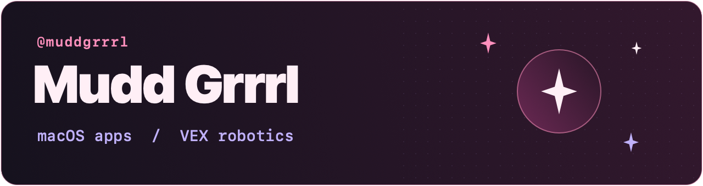

  

  
  
  

I’m a student at **St. George’s Independent School, Collierville Campus**. I build playful Mac utilities, tinker with VEX robotics, and make little tools for things I do all the time.

## Featured apps

<table>
  <tr>
    <td width="124" align="center">
      
    </td>
    <td>
      <strong><a href="https://github.com/muddgrrrl/OpenWhip-Mac">OpenWhip for macOS</a></strong> 
      A menu bar whip with rope physics, a synthesized crack, and optional nudges for AI chats and terminals. 
      <a href="https://github.com/muddgrrrl/OpenWhip-Mac/releases/latest">Download OpenWhip</a>
    </td>
  </tr>
</table>

- **[Desk Toys](https://github.com/muddgrrrl/Desk-Toys)** · Desk Bell, Focus Fuse, and Prompt Pocket in one collection of Mac apps.
- **[Signal Sift](https://github.com/muddgrrrl/Signal-Sift)** · Search Hacker News and the wider press from a native Mac window.

## Small tools

| Project | What it does |
| --- | --- |
| [Palette Drop](https://github.com/muddgrrrl/Palette-Drop) | Pull a color palette from a local image and export CSS or JSON. |
| [Repo Pulse](https://github.com/muddgrrrl/Repo-Pulse) | See your Git branch, changes, and recent commits at a glance. |
| [Subtitle Shift](https://github.com/muddgrrrl/Subtitle-Shift) | Fix subtitle timing or cut captions to match a clip. |
| [Release Receipt](https://github.com/muddgrrrl/Release-Receipt) | Check a Mac app ZIP’s hash and processor support. |
